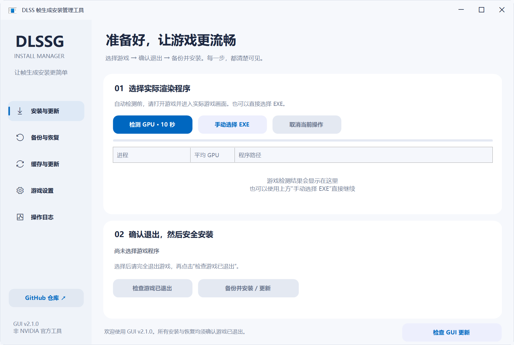

# DLSSG Install Manager

Windows 中文 DLSS 帧生成安装管理器。选择游戏 → 确认退出 → 备份并安装，自动处理完整文件包、集中缓存与恢复。

[正式版下载](https://github.com/BerryFuwawa/dlssg-install-manager/releases/latest) · **[新手教程](docs/新手教程.md)** · [使用说明](docs/使用说明.md) · [常见问题](docs/常见问题.md) · [界面截图](docs/界面截图.md)

当前正式版本 **v2.1.0**：适配上游 0.4.x 完整包，RTX 40 系标为实验性支持。使用 v2.0.0 的用户请先更新管理器，再安装当前上游完整包。

## 第一次使用

1. 下载便携包，右键“全部解压缩”，打开其中的 EXE。不要下载开发者使用的 Source code。
2. 游戏进入实际画面后点击 **检测 GPU · 10 秒**；检测失败时点 **手动选择 EXE**，选好后就在当前页面继续。
3. 核对完整路径，正常退出游戏，点 **检查游戏已退出**。
4. 点 **备份并安装 / 更新**，核对确认框。首次准备完整包需要联网，窗口显示文件与下载字节进度。
5. 部署完成后，在游戏自己的设置里验证帧生成。想撤销时退出游戏，到 **备份与恢复** 选择对应记录。

不需要命令行、Python、CUDA Toolkit 或 .NET SDK。系统要求 Windows 10/11 x64、.NET Framework 4.7.2+。完整步骤见[新手教程](docs/新手教程.md)。

## 显卡支持

| 显卡 | 管理器提示 |
| --- | --- |
| RTX 20 / 30 | 上游提供适配 |
| RTX 40，包括 Laptop、Ti、SUPER | 实验性支持，使用上游 PTX 路线 |
| 其他显卡 | 提示查阅上游，不据名称宣称兼容 |

上游 0.4.x 要求 NVIDIA **R580 或更新驱动**、Windows x64 / D3D12。具体要求以[上游说明](https://github.com/sdli1995/dlssg_for_sm86)为准。

## 完整包与备份

从同一上游提交获取根目录的 version.dll、dlssg_sm86.ini 和整个 dlssg_sm86/ 发布目录，包含后端、帧生成内核包、运行库等。更新前逐文件备份，新增、覆盖和移除的文件均有记录。

运行日志 dlssg_sm86/logs/ 不覆盖、不删除。恢复原文件时，只移除仍属于所选安装记录的新增文件；未列入该恢复点的新文件保留。v2.0.0 与旧批处理备份继续可恢复，范围仍为原来的两个文件。

每次安装检查上游提交，缓存有效且提交未变时不重复下载。网络不可用时复用有效完整缓存，并提示离线状态。旧版两文件缓存需联网重建一次，失败时保留旧缓存与游戏原文件。

安装/更新使用官方默认 INI，不自动合并自定义参数。修改日志等级只备份并修改 INI，不复制整个运行库。发现其他根目录代理名称时列出供核对，不自动删除。

## 文件放在哪里

点击 **缓存与更新 → 打开缓存与备份目录**，即可进入 Windows“文档”中的 DLSS帧生成安装管理工具 文件夹。文档重定向到其他盘或 OneDrive 时跟随系统位置。

| 子项 | 用途 |
| --- | --- |
| 缓存 | 完整包、README、缓存清单.json |
| 备份 | 原文件备份、manifest.json、恢复说明.txt |
| 程序更新 | GUI 更新暂存 |
| settings.json | 管理器设置 |
| 最近一次恢复说明.txt | 最近操作的恢复说明 |

删除管理器 EXE 不会撤销游戏修改；想撤销时先恢复，保留备份目录。

## GUI 更新与界面

默认启动时检查正式 Release，右下角红灯表示管理器有新版，点击确认后更新重启。游戏 DLL 更新与 GUI 更新分别进行；v2.1.0 保持 v2.0.0 的 GUI 更新协议。

Windows 11 风格圆角、点击反馈，兼容 Windows 10；字体、控件和表格按显示器 DPI 缩放，高缩放小屏幕可滚动。

## 已知限制

- 非 NVIDIA 官方工具，只用于允许修改的游戏；不绕过反作弊，不承诺在线游戏账号安全。
- 部署完成不等于游戏内帧生成已启用，不为没有相应功能的游戏添加开关，也不强制解锁倍率。
- RTX 40 尚无本项目实卡验证，不承诺性能或倍率。Win10 尚未在独立设备实测。
- 只自动部署 version.dll 代理，不自动切换其他代理、不合并旧 INI、不提供超分配置界面。
- EXE 未签名。请核对来源，不要关闭安全功能；哈希用于文件一致性，不等同于数字签名。

## 开发与测试

~~~powershell
powershell -NoProfile -ExecutionPolicy Bypass -File .\build.ps1 -Test
powershell -NoProfile -ExecutionPolicy Bypass -File .\screenshots.ps1
powershell -NoProfile -ExecutionPolicy Bypass -File .\package.ps1
~~~

使用系统 .NET Framework C# 编译器，无 NuGet 或第三方 UI 依赖。93 项核心/更新检查和 60 项 UI/DPI 检查覆盖完整包、恢复、v2.0.0 → v2.1.0 更新和 100%–300% 缩放。真实上游包仅部署到隔离的假游戏目录。[测试记录](docs/测试记录.md) · [开发与发布](docs/开发与发布.md)

## 开源与反馈

源码使用 [MIT License](LICENSE)。上游 DLL 和第三方组件遵循各自许可，不随本管理器重新授权；便携包不包含上游 DLL，安装时从原作者仓库获取。

到 [Issues](https://github.com/BerryFuwawa/dlssg-install-manager/issues) 反馈版本、系统、显卡、游戏、步骤与完整错误。分享日志或截图前遮盖私人路径和用户名。
