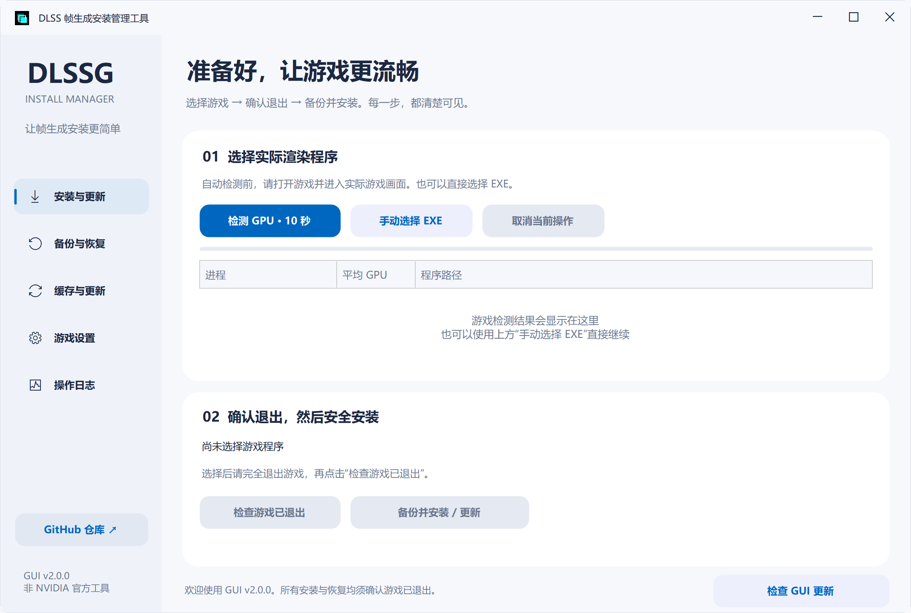

# DLSSG Install Manager

Windows 中文图形化 DLSS 帧生成安装管理工具。Windows 11 Fluent 风格、圆角窗口与卡片，兼容 Windows 10；真实 GPU 采样、集中缓存与备份，让安装、更新和恢复都有清楚的操作反馈。

[下载最新版](https://github.com/BerryFuwawa/dlssg-install-manager/releases/latest) · **[新手一步一步教程](docs/新手教程.md)** · [完整使用说明](docs/使用说明.md) · [常见问题](docs/常见问题.md) · [反馈问题](https://github.com/BerryFuwawa/dlssg-install-manager/issues)



[查看全部 6 张界面截图](docs/界面截图.md)（含各页面和模拟的更新红灯）。

> 非 NVIDIA 官方工具，也不是上游 DLL 的官方安装器。仅用于允许修改的游戏。在线游戏、反作弊或完整性校验可能阻止加载、导致封禁或损坏兼容性；本工具不绕过这些机制，也不能证明某个游戏安全可用。尤其不要把“成功复制文件”当成“游戏允许使用”。

## 快速开始

**第一次用？先看[新手教程](docs/新手教程.md)。不会下载 GitHub 文件、找不到游戏 EXE、安装按钮是灰色，都有对应说明。**

1. 打开[下载页](https://github.com/BerryFuwawa/dlssg-install-manager/releases/latest)，展开 **Assets**，下载 `DLSSG-Install-Manager-v2.0.0-portable.zip`（程序 + 离线教程），右键“全部解压缩”后打开其中的 `DLSSG-Install-Manager.exe`。不要下载 `Source code`，那是开发者用的源码。不需要 Python 或 .NET SDK。
2. 打开游戏并进入实际游戏画面，回到工具点击 **检测 GPU · 10 秒**。也可以直接 **手动选择 EXE**，选好后就在当前页面继续安装。
3. 核对选中的程序路径，完全退出游戏，点击 **检查游戏已退出**。
4. 点击 **备份并安装 / 更新**，确认目标与风险。工具检查上游更新、准备缓存、备份原文件，再替换 DLL 和配套 INI。
5. 如需撤销，在 **备份与恢复** 中选择记录，退出游戏后恢复。

适用于 Windows 10/11 x64、.NET Framework 4.7.2 或更新版本。GPU 自动检测需要可用的 Windows GPU Engine 计数器；失败时手动选择仍然可用。游戏及显卡支持情况以[上游项目说明](https://github.com/sdli1995/dlssg_for_sm86)为准。

**本工具不能给原本没有 DLSS 帧生成功能的游戏凭空添加开关，也不承诺兼容任何在线游戏。** 当前只部署 `version.dll` 与 `dlssg_sm86.ini`，不自动改名为其他代理 DLL。安装/更新会备份后写入配套 INI：已有自定义参数请先另存，更新后核对，不会自动合并。

## 不懂这些名字也能用

| 界面里的名字 | 可以这样理解 |
| --- | --- |
| GUI / 管理器 | 你现在打开的这个带窗口的软件 |
| 游戏主程序 / EXE | 真正运行游戏画面的程序，不是下载器或启动器 |
| DLL | 放在游戏主程序旁边、供游戏加载的组件，不要双击运行 |
| INI | DLL 的设置文件，本工具使用上游配套默认配置 |
| 缓存 | 下载好后留一份，下次装其他游戏就不必重复下载 |
| 备份 / 恢复点 | 修改前的文件副本，出问题时用于撤销本次修改 |

## 文档导航

- [新手教程](docs/新手教程.md)：从下载到首次安装、更新、撤销，逐步操作。
- [使用说明](docs/使用说明.md)：各页面功能、安全检查与文件存放规则。
- [界面截图](docs/界面截图.md)：五个功能页面与更新红灯示例。
- [常见问题](docs/常见问题.md)：按钮灰色、检测失败、404、网络与权限等问题。
- [开发与发布](docs/开发与发布.md)：面向开发者的构建和更新协议。
- [测试记录](docs/测试记录.md)：已验证内容与未覆盖的兼容性边界。

## 主要功能

- Fluent 浅色侧栏、线性图标、蓝色选中标记、圆角窗口/卡片/按钮，自绘标题栏支持拖动、双击最大化和边缘缩放；悬停、按下、键盘焦点和忙碌状态反馈，后台工作不阻塞窗口。
- Per-Monitor DPI 适配：字体、按钮、图标、表格、间距与圆角同步缩放，跨屏 DPI 变化自动重新布局；屏幕空间不足时滚动访问操作区。左下角“GitHub 仓库”打开本管理器仓库。
- 原生 PDH 批量 GPU 采样，按每个进程最忙引擎排序；显示实际经过时间，而不是把循环次数冒充秒数。
- 排除 LockApp、桌面合成器等常见系统界面程序，拒绝无效、NaN、Infinity 和无法定位路径的样本。高负载不是“游戏身份证”，安装前仍需核对。
- 原生 `QueryFullProcessImageName` 读取路径，失败后尝试 WMI；同名进程路径不可读时，不冒险判定游戏已退出。
- 同一上游提交的 DLL + 官方配套 INI；不再请求已移除的 `docs/NATIVE_INI.md`。
- 文档目录集中缓存与备份；提交未变且缓存有效，不重复下载约 30 MB 的 DLL。离线时只使用已校验缓存。
- 安装前、下载后、备份后重新检查游戏进程；部署失败尝试回滚。恢复前校验原备份并保存当前文件快照。
- 兼容游戏目录内旧版 `DLSS帧生成备份`；支持查看实际文件哈希、调整运行日志等级、导出本次日志。
- **GUI 自身更新**：默认启动时检查正式 Release，发现新版本后在右下角显示红灯；点击确认后下载、校验、备份旧 EXE、替换并重启。游戏 DLL 更新独立进行。

## 文件放在哪里

通过 Windows 文档目录 API 定位，兼容文档目录重定向，不硬编码 `C:\Users`：

```text
文档\DLSS帧生成安装管理工具\
├─ 缓存\
│  ├─ version.dll
│  ├─ dlssg_sm86.ini
│  ├─ README.md
│  └─ 缓存清单.json
├─ 备份\备份_日期时间_随机编号\
│  ├─ 原文件备份\
│  ├─ manifest.json
│  ├─ 恢复说明.txt
│  └─ 恢复前现状_随机编号\  （执行恢复时创建）
├─ 程序更新\                 （GUI 更新暂存）
├─ settings.json
└─ 最近一次恢复说明.txt
```

游戏目录只管理 `version.dll`、`dlssg_sm86.ini`，并尽力写入最近一次恢复说明。缓存更新、备份和恢复共用跨实例文件锁，避免两个窗口同时写入。

## 两种更新，互不混淆

| 更新对象 | 检查时机 | 来源 | 提示与操作 |
| --- | --- | --- | --- |
| GUI 程序 | 启动时（可关闭）或点击右下角 | 本仓库正式 Releases | 新版红灯 → 点击确认 → 下载校验 → 退出替换并重启 |
| 游戏 DLL | 每次安装或“检查 DLL 缓存更新” | `sdli1995/dlssg_for_sm86` 默认分支 HEAD | 比较提交 SHA；命中缓存、在线更新或离线缓存都有日志 |

GUI 不会在后台静默替换自己。更新失败不会删除缓存与游戏备份；旧 EXE 留在原程序旁边。哈希校验提供传输与缓存一致性检查，不等同于数字签名或独立审计。

## 从源码构建

```powershell
powershell -NoProfile -ExecutionPolicy Bypass -File .\build.ps1 -Test
```

使用 Windows .NET Framework 自带 C# 编译器，无 NuGet、无第三方 UI 库。产物在 `dist`；`package.ps1` 生成便携 ZIP。测试均使用隔离的假游戏目录，不向真实游戏部署。

本版验证：63 项核心/更新测试、60 项界面/DPI 状态检查通过，覆盖 100%–300% 的布局回归、相同 DPI 重复刷新与原生 DPI 变化消息处理；实机三轮 GPU 采样窗口分别约 10.012、10.016、10.006 秒，样本间隔约 0.987–1.018 秒。另已验证真实上游下载和缓存复用。未宣称对所有显示器、游戏、驱动或显卡完成兼容性实测。详见[测试记录](docs/测试记录.md)。

## 开源与致谢

GUI 管理器源码使用 [MIT License](LICENSE)。本仓库不打包或重新授权 NVIDIA 组件、上游 DLL；安装时从[原作者仓库](https://github.com/sdli1995/dlssg_for_sm86)获取，相关组件遵循各自许可。感谢上游作者与测试者。
