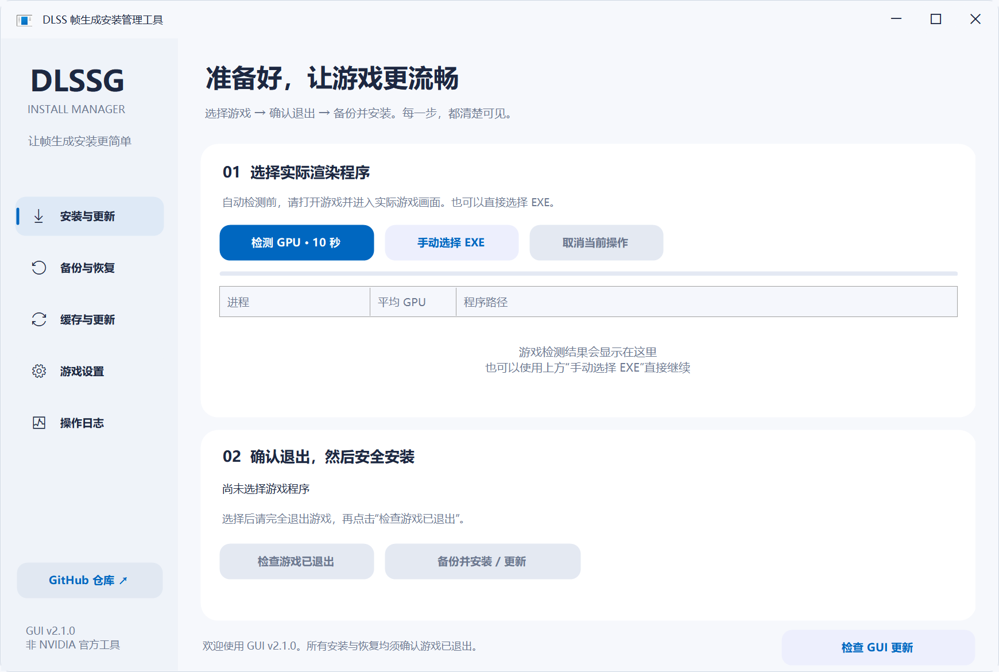
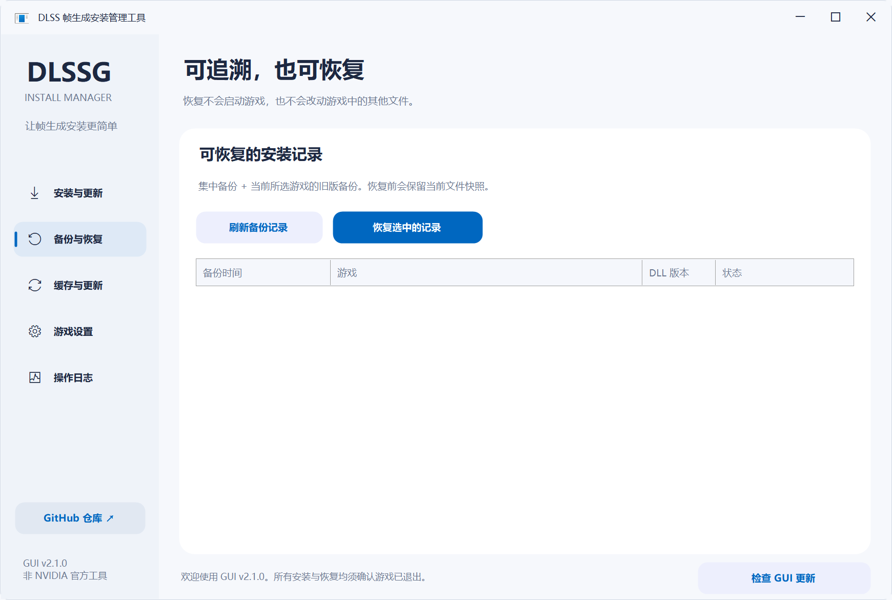
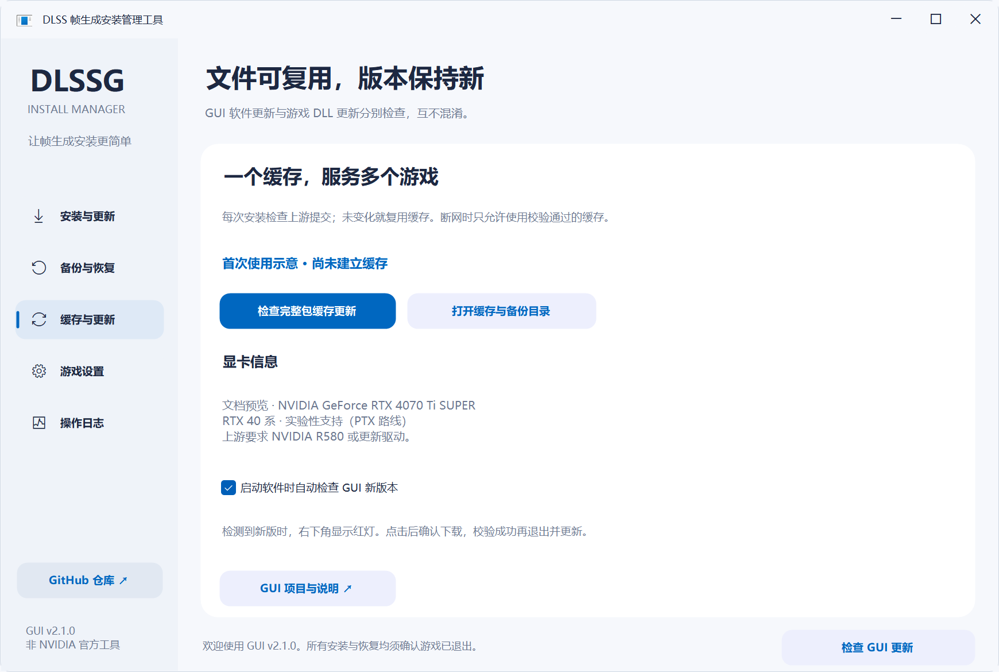
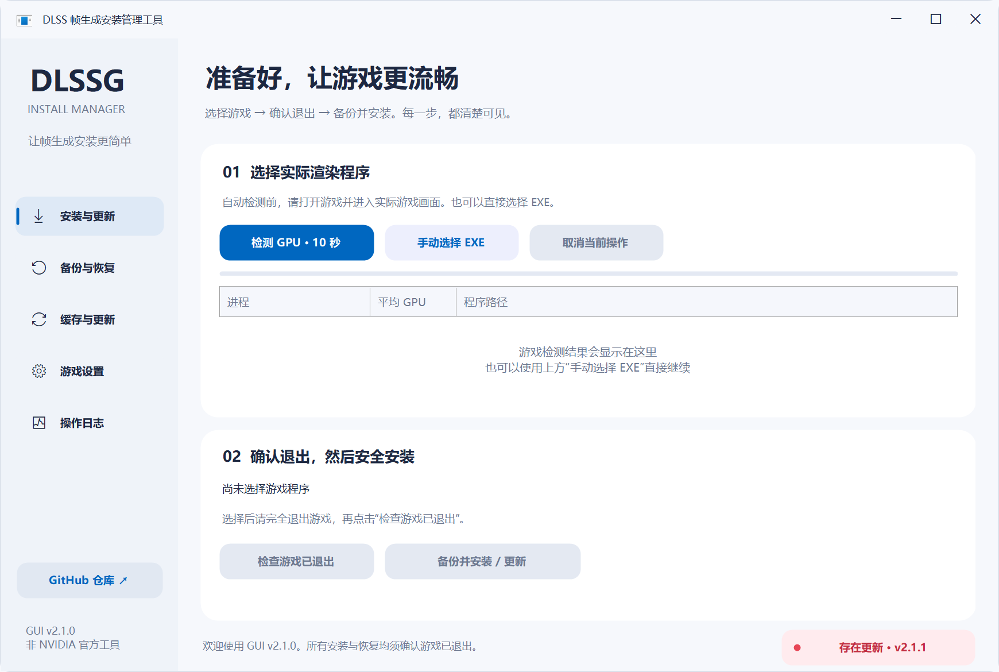

# 新手教程：从下载到恢复

适用版本：v2.1.0。你不需要写代码或使用命令行。

## 1. 下载并打开

打开[下载页](https://github.com/BerryFuwawa/dlssg-install-manager/releases/latest)，找到下方 **Assets** 附件列表，下载 **DLSSG-Install-Manager-v2.1.0-portable.zip**。已在使用 v2.0.0 时，也可以点击程序右下角的更新提示。

右键 ZIP → **全部解压缩**，打开解压后的文件夹，双击 **DLSSG-Install-Manager.exe**。不要直接在压缩包预览里运行。

| 附件 | 怎么用 |
| --- | --- |
| portable.zip | 推荐，包含程序、教程与截图 |
| DLSSG-Install-Manager.exe | 只有程序，也可以独立运行 |
| update-manifest.json | 自动更新用，不必手动打开 |
| Source code | 源码，普通使用者不用下载 |

需要 Windows 10/11 64 位和 .NET Framework 4.7.2+，不需要 Python、CUDA Toolkit 或 .NET SDK。缺少框架时从 Windows 更新或[微软官网](https://dotnet.microsoft.com/download/dotnet-framework)获取。

打开成功后，左侧有五个页面：

## 2. 先确认适用条件

先确认目标游戏允许安装这种模组。上游 0.4.x 要求 NVIDIA **R580 或更新驱动**及 D3D12；具体显卡要求见[上游说明](https://github.com/sdli1995/dlssg_for_sm86)。

RTX 20/30 有上游适配。RTX 40，包括 Laptop、Ti、SUPER，在本工具中标为“实验性支持”。可以在 **缓存与更新** 页查看显卡信息。

GUI 是这个窗口程序；EXE 是游戏程序；DLL 是供游戏加载的组件，不要双击运行；INI 是设置文件；缓存是下载文件的留存副本；备份是修改前的文件。

## 3. 选择真正的游戏主程序

### 方法 A：自动检测

1. 照常启动游戏，进入实际游戏场景，不要停在启动器或更新器。
2. 切回工具，点击 **检测 GPU · 10 秒**，在提示中确认。
3. 等候采样完成。表格会显示程序名、平均 GPU 占用和完整路径。
4. 核对选中项是否确实属于该游戏。选错时点正确的一行，或改用手动选择。

十秒是采样窗口，准备计数器和识别路径可能另花一点时间。部分游戏切后台后会降帧，检测失败时直接用方法 B。

### 方法 B：手动选择

1. 在游戏平台使用“浏览本地文件”或“打开安装目录”，找到游戏文件夹。
2. 点击工具的 **手动选择 EXE**。
3. 选真正运行游戏画面的程序。它可能在 Binaries/Win64、bin、_retail_ 等子目录，具体以游戏为准。
4. 查看工具下方的完整路径。

不要选 launcher、updater、uninstaller，也不要选管理器自己的 EXE。找不到时，可以在游戏运行中打开任务管理器，定位游戏进程，右键“打开文件所在的位置”（系统允许时）。

**手动选好后就在同一页继续，不需要再做自动检测。** 无法确认主程序就先停下询问，不要猜一个文件覆盖。

## 4. 退出游戏，再做退出检查

1. 在游戏菜单正常退出，等待保存和关闭完成。
2. 必要时用任务管理器确认游戏进程已经结束。
3. 回工具点击 **检查游戏已退出**。
4. 看到“已确认游戏退出”，安装按钮可以点击。

按钮仍灰色时查看提示，先关闭残留的游戏再检查。更换目标后需要重新检查。下载和备份期间不要重新启动游戏。

## 5. 备份并安装完整包

1. 点击 **备份并安装 / 更新**。
2. 核对弹窗里的 EXE、目标目录和备份位置。目标不对就选“否”，回去重新选择。
3. 若提示有 winmm.dll、dxgi.dll 等其他代理名称，先核对来源；不要删除不认识的 DLL。
4. 确认后等待准备缓存、备份和部署，右下方显示下载文件数与字节进度。
5. 看到“部署完成”后，再启动游戏。

这次不是只装一个 DLL，而是安装：

~~~text
游戏主程序旁边\
├─ version.dll
├─ dlssg_sm86.ini
└─ dlssg_sm86\       后端、内核包、运行库等完整载荷
~~~

使用官方默认 INI，旧 INI 先备份，不自动合并自定义参数。有自定义配置时请先另存，更新后按新说明核对。工具不会自动删除其他名称的根目录代理。

从 v2.0.0 升级后，旧缓存需要联网重建一次；准备失败会保留旧缓存和游戏原文件。完成后无需手动复制缓存内容。

## 6. 在游戏里验证

照常启动游戏，到游戏自己的图形或显示设置中查看 DLSS 帧生成选项，有对应功能时按游戏和上游说明启用。工具不会替你点击游戏菜单或强制选择倍率。

没有开关、无法加载或游戏打不开时，先退出、保留日志，必要时恢复，不要不断重复覆盖。

## 7. 撤销安装或更新

1. 完全退出对应的游戏。
2. 点击左侧 **备份与恢复** → **刷新备份记录**。
3. 根据游戏路径、时间和状态选择记录，不要只看程序名称。
4. 点击 **恢复选中的记录**，再次核对目标后确认。
5. 看到恢复完成，再启动游戏检查。

恢复的是**所选操作之前**的状态。例如装过 A 版又更新 B 版，恢复 B 的记录会回到 A。完全撤销时应找第一次安装前的对应记录。

新恢复点包含完整载荷，旧版恢复点仍只处理当时的两个文件。运行日志不会删除。若新增文件被其他工具修改，工具会提示而非直接删除。

有疑问时到 **游戏设置 → 最近一次恢复说明**，或在具体备份目录查看恢复说明.txt。不要直接清空备份。

找旧批处理记录时，先手动选原游戏 EXE，再刷新备份；旧版 DLSS帧生成备份 保持原目录结构。

## 8. 缓存与两种更新

给另一个游戏安装时，重新选它的 EXE，正常退出检查并安装即可。完整缓存会跨游戏复用，各游戏备份仍独立保存。

| 提示 | 意思 |
| --- | --- |
| 缓存命中 | 上游提交未变，不重复下载 |
| 正在更新缓存 | 上游有变化，或缓存需要重建 |
| 离线缓存 | 联网检查失败，使用已校验的完整包，不一定是最新版 |
| 没有有效完整缓存 | 需要联网后重试，当前不安装 |

**检查完整包缓存更新** 只准备公共文件，不会替所有游戏更新。

右下角红灯表示的是 **GUI 管理器**有新版，不是游戏 DLL。点击红灯、确认后，下载校验成功才关闭窗口、替换并重启。可以在缓存页关闭“启动软件时自动检查 GUI 新版本”。

## 9. 文件在哪里，怎么卸载

点击 **缓存与更新 → 打开缓存与备份目录**，会打开 Windows“文档”中的 DLSS帧生成安装管理工具 文件夹；文档被重定向时跟随系统位置。

缓存保存完整包，备份保存每次修改前的文件，程序更新保存 GUI 暂存。游戏运行日志在游戏目录的 dlssg_sm86/logs/，更新与恢复时保留。

管理器是便携程序。想撤销游戏修改，应先恢复；**删除 EXE 不等于撤销游戏安装**。保留文档里的备份，才能日后恢复。

## 10. 遇到问题怎么求助

先查[常见问题](常见问题.md)。关闭窗口前，从 **操作日志 → 导出本次日志** 保存记录，到[Issues](https://github.com/BerryFuwawa/dlssg-install-manager/issues)提供版本、系统、显卡、游戏、操作步骤和错误全文。

截图和日志分享前遮盖私人路径、用户名；不发送密码、令牌、整个游戏或备份目录。

## 已知限制

- 非 NVIDIA 官方工具，仅用于允许修改的游戏；在线、竞技和反作弊游戏可能禁止使用。
- 部署成功不代表帧生成已启用、游戏兼容、性能提高或账号安全，也不能给不支持的游戏添加开关。
- RTX 40 为实验性支持，未进行本项目实卡验证，不保证倍率。独立 Win10 设备尚未实测。
- 只自动部署 version.dll 代理，不自动切换其他代理、不合并自定义 INI、不提供超分设置。
- EXE 未签名。请核对来源；不确定时停止，不要关闭安全软件或绕过组织策略。默认不必管理员运行。
