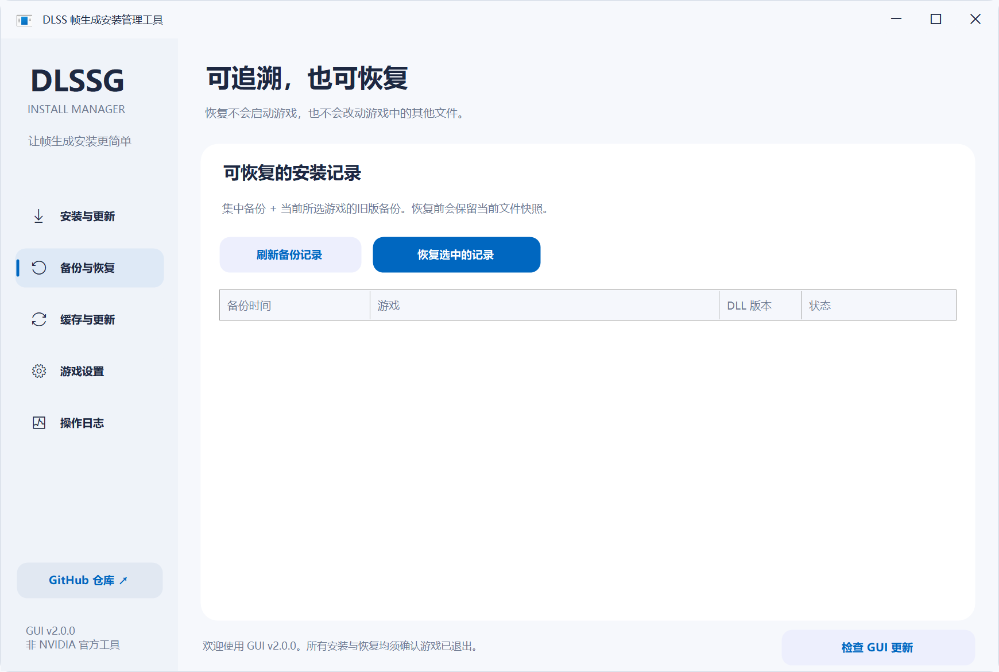
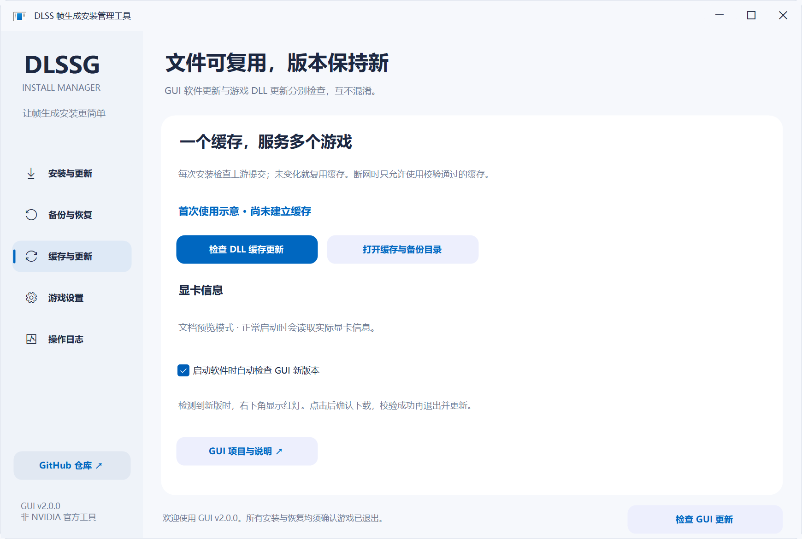
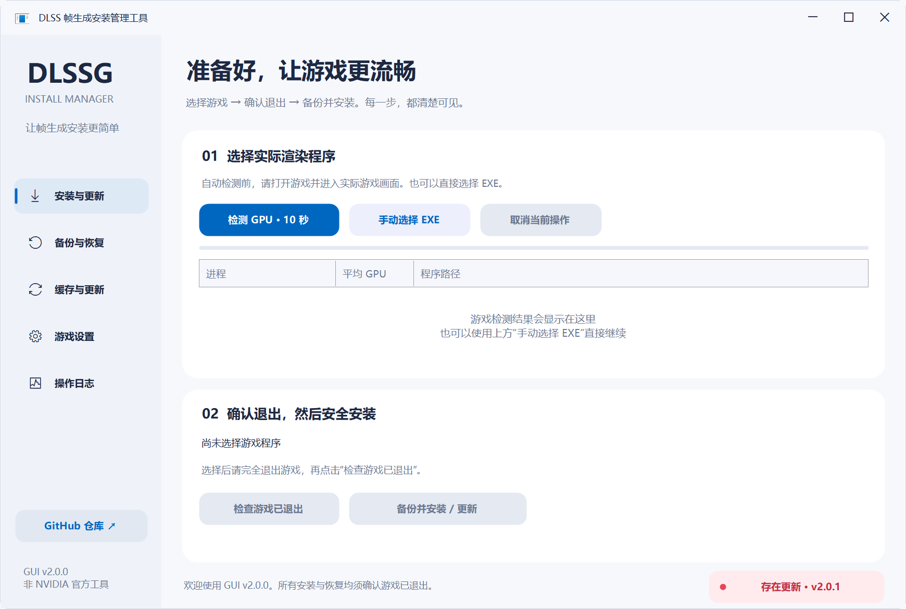

# 新手教程：第一次使用，从这里开始

适用版本：GUI v2.0.0。你不需要会写代码，也不需要使用命令行。请按下面顺序操作，不确定目标文件或游戏是否允许修改时，先停下来。

## 先知道：这个软件能做什么

它帮助你把上游 DLSS 帧生成组件放到正确的游戏目录，修改前自动备份，之后可以恢复。它不是游戏启动器，不是显卡驱动，也不是 NVIDIA 官方软件。

**先确认游戏允许使用这类模组。** 在线、竞技、带反作弊的游戏可能拒绝运行或封禁账号，本工具无法替你判断安全性。不要因为列表里找得到游戏，就认为该游戏允许使用。

上游主要面向部分 NVIDIA RTX 20/30 系列、Windows x64 / D3D12 游戏；具体要求会更新，请以[上游 README](https://github.com/sdli1995/dlssg_for_sm86)为准。管理器能打开，并不表示你的显卡或游戏支持帧生成。没有帧生成功能的游戏，单靠复制 DLL 不会自动多出设置开关。

## 第 1 步：下载正确的文件

1. 打开[最新版下载页](https://github.com/BerryFuwawa/dlssg-install-manager/releases/latest)。
2. 找到页面下方的 **Assets**（附件列表），如果收起来了就点一下展开。
3. 首次使用推荐下载 `DLSSG-Install-Manager-v2.0.0-portable.zip`。以后版本号可能不同，选名字结尾为 `portable.zip` 的文件即可。
4. `Source code (zip)` 和 `Source code (tar.gz)` 是源码，不是已经编译好的软件，普通使用者不用下载。

附件的区别：

| 文件 | 用途 |
| --- | --- |
| `DLSSG-Install-Manager-v2.0.0-portable.zip` | 推荐：程序、教程、说明文档打包在一起 |
| `DLSSG-Install-Manager.exe` | 只下载程序；也可以单独运行 |
| `update-manifest.json` | 软件自动更新用的校验信息，不需要手动打开或编辑 |
| `Source code …` | 给需要查看、修改或自行编译源码的人 |

首次给游戏安装还需要能访问 GitHub，因为下载包不包含上游游戏 DLL。软件本身不要求 GitHub 登录，更不会向你索要密码或访问令牌。

## 第 2 步：解压并打开

1. 打开 Windows 的“下载”文件夹，找到下载好的 ZIP。
2. 右键 ZIP → **全部解压缩**，选一个自己能写入的普通文件夹。
3. 打开解压后的文件夹，双击 `DLSSG-Install-Manager.exe`。**不要直接在压缩包预览里运行。**
4. 看到左侧有“安装与更新、备份与恢复、缓存与更新、游戏设置、操作日志”，就打开成功了。

系统需要 Windows 10/11 64 位和 .NET Framework 4.7.2 或更新版本。不需要安装 Python、CUDA Toolkit 或 .NET SDK。若系统明确提示缺少 .NET Framework，可通过 Windows 更新或[微软官方 .NET Framework 页面](https://dotnet.microsoft.com/download/dotnet-framework)获取，不要下载来路不明的“运行库合集”。

当前管理器 EXE 没有数字签名，可能出现信誉未知提示。请核对下载地址和来源；不确定时停止运行或请可信的人检查。不要关闭杀毒软件、添加大范围排除或绕过组织安全策略。默认不必管理员运行；有权限错误时先阅读[常见问题](常见问题.md)。

## 第 3 步：让工具选到真正的游戏程序

有两种方法，选其中一种即可。**手动选择后可以直接继续安装，不需要再做自动检测。**

### 方法 A：自动检测（推荐先试）

1. 照常启动游戏，进入真正的游戏画面，最好进入可操作的场景。不要停在下载器或启动器界面。
2. 切回工具，点击 **检测 GPU · 10 秒**。
3. 在提示框点击确定，保持游戏运行，等待采样结束。
4. 表格里会出现程序名、平均 GPU 占用、完整路径，首项会自动选中。
5. **亲自核对选中项。** 路径应该属于你要安装的游戏，程序不应是播放器、启动器、更新器或卸载器。若选错，点击正确的那一行；不确定就用方法 B。

切回桌面后有些游戏会降帧甚至暂停渲染，自动检测可能失败。不要反复盲猜候选，改用手动选择即可。显示的十秒是采样窗口，准备计数器和识别程序路径可能另花一点时间。

### 方法 B：手动选择（自动失败时用）

1. 在游戏平台找到“浏览本地文件”或“打开安装目录”（各平台名称可能不同），打开游戏文件夹。
2. 在工具点击 **手动选择 EXE**。
3. 浏览到真正运行游戏画面的 `.exe` 文件并打开。游戏主程序可能藏在 `Binaries\Win64`、`bin`、`_retail_` 等子目录；这些只是常见目录名，不能当作固定规则。
4. 查看工具下方显示的完整路径，确认是目标游戏。

`launcher.exe` 通常是启动器，`updater.exe` 通常是更新器，`uninstaller.exe` 是卸载器，不要选这些。**不要选管理器自己的 EXE。**

找不到主程序时，可以在游戏运行时打开任务管理器，定位游戏进程，右键查看“打开文件所在的位置”（系统允许时），再回工具选择该目录里的程序。仍无法确认就先停止，向游戏社区或维护者询问，不能拿某个 EXE 试着覆盖。

## 第 4 步：彻底退出游戏

1. 选好程序后，在游戏菜单里正常退出游戏。
2. 等待游戏窗口关闭、退出保存完成。必要时看任务管理器确认实际游戏进程已结束。
3. 回到工具点击 **检查游戏已退出**。
4. 成功时会显示“已确认游戏退出”，**备份并安装 / 更新** 按钮可以点击。

如果按钮仍是灰色，查看提示：游戏可能还在后台运行，或工具无法确认同名进程的路径。先正常关闭残留游戏，再点一次检查。工具不会替你强行结束游戏，也不会绕过这个检查。

换选另一个程序后，之前的退出确认会作废，需要重新检查。下载或备份期间也不要重新启动游戏，否则安装会停止。

## 第 5 步：备份并安装

1. 点击 **备份并安装 / 更新**。
2. 阅读确认框中的游戏 EXE、目标目录和风险提示。**目标不对就选“否”，返回重新选择。**
3. 确认允许修改且目标正确后，选择“是”。
4. 等待工具检查更新、准备文件、建立备份并安装。第一次需要下载 DLL；网络慢时耐心等待，不要直接关机。
5. 看到“安装完成”的提示，才表示文件部署成功。可到 **操作日志** 查看过程。

**重要：本版会备份后写入 `version.dll` 和官方配套 `dlssg_sm86.ini`，不会自动合并你以前改过的 INI。** 如果你有自定义参数或其他模组也使用同名文件，先额外留一份，并确认是否冲突。不要把已有 `version.dll` 当垃圾删掉，它可能属于别的模组。

无需手动复制缓存里的文件。没有有效缓存且下载失败时，工具会停止，不会为了继续安装使用未验证文件。

## 第 6 步：进游戏验证

1. 安装成功后，照常启动游戏。
2. 在游戏自己的图形/显示设置中查看 DLSS 帧生成选项；有相应选项且游戏支持时，再按游戏和[上游说明](https://github.com/sdli1995/dlssg_for_sm86#安装与升级)开启。
3. 先用保守设置试一段时间，确认没有崩溃、花屏等异常。

“安装完成”只表示文件复制和校验成功，**不等于已经在游戏里打开帧生成，也不保证兼容、性能提升或账号安全。** 本工具不会自动点击游戏菜单，不自动选择倍率。

没有开关、无法加载或游戏打不开时，不要不断重复安装。先按下一节恢复，再查看[常见问题](常见问题.md)。本版只管理 `version.dll` 代理，不自动安装上游其他代理文件，也不建议新手自行乱改 DLL 文件名。

## 想撤销安装：这样恢复

1. 完全退出对应的游戏。
2. 打开工具，点击左侧 **备份与恢复**，点击 **刷新备份记录**。
3. 根据游戏路径、时间和状态选择正确的记录，不要只看程序名。
4. 点击 **恢复选中的记录**，再次核对弹窗里的目标目录和时间，确认后等待完成。
5. 看到恢复完成后，再启动游戏检查。

恢复的是**所选那次修改之前**的状态，不一定是“完全没有模组”的状态。比如安装了 A 版、再更新 B 版，恢复 B 版的备份会回到 A 版。想完全撤销，需要找到第一次安装前的对应记录；如果不能确认，先看恢复说明，不要乱选。

若提示备份损坏或文件已被其他工具修改，先停止，不要手动删掉同名文件。打开 **游戏设置 → 最近一次恢复说明** 查看，或点击 **缓存与更新 → 打开缓存与备份目录** 查看具体备份中的 `恢复说明.txt`。原备份和恢复前快照都应保留。

从旧批处理工具迁移：先手动选中原游戏 EXE，再进入备份页刷新；工具会在当前游戏附近查找旧版 `DLSS帧生成备份`。不是任意盘全局搜索，找不到时请保留原目录结构并反馈。

## 下次使用：不用每个游戏都重新下载

安装到第二个游戏时，重新选择第二个游戏，正常走“退出检查 → 备份并安装”即可。

- 日志显示 **缓存命中**：文件没变，直接复用，仍会为这个游戏创建独立备份。
- 显示正在更新缓存：上游有新提交或本地缓存需要重新准备，下载后再安装。
- 显示 **离线缓存**：联网检查失败，使用上次校验通过的文件；它不一定是最新版。
- 没有有效缓存且网络不可用：停止安装，联网后再试。

“缓存与更新”中的 **检查 DLL 缓存更新** 只准备公共文件，**不会替所有游戏自动更新**。要更新某个游戏，仍要选中它、退出它、再安装。

## 右下角红灯：更新的是这个窗口程序

工具默认启动时检查 GUI 新版本。发现新版时，右下角显示红点和 **存在更新 · v版本号**。

1. 先结束正在进行的安装、恢复等操作。
2. 点击右下角更新提示，阅读版本信息，确认更新。
3. 下载和校验成功后，当前窗口会关闭，替换程序后自动重新打开。
4. 缓存与游戏备份不会因为更新 GUI 被删除。

这和游戏 DLL 更新是两回事：更新管理器不会给所有游戏换 DLL，更新 DLL 也不会关闭 GUI 红灯。不想启动时联网检查，可在 **缓存与更新** 取消勾选 **启动软件时自动检查 GUI 新版本**，以后仍可手动点击右下角检查。

自动更新失败时，到下载页重新下载便携包，解压到新文件夹打开即可；先保留旧程序和备份，不要清空文档目录。

## 缓存和备份在哪里？能删吗？

最简单的方法：点击 **缓存与更新 → 打开缓存与备份目录**，不用自己猜 Windows 用户名或盘符。

默认位置是 Windows 的“文档”中 `DLSS帧生成安装管理工具` 文件夹。若你的“文档”已重定向到其他盘或 OneDrive，会跟随那个位置。

- **缓存**：下载好的公共文件。删除后下次需要重新下载；不要在安装过程中操作它。
- **备份**：各次修改之前的文件，**不要随意删除**。
- **程序更新**：GUI 自动更新的暂存目录。
- **最近一次恢复说明.txt**：最新操作对应的说明，不是所有游戏的汇总。

管理器是便携软件，没有必须运行的卸载程序。**删除管理器 EXE，不等于撤销游戏里的 DLL。** 想撤销游戏修改，先执行恢复；想保留日后恢复能力，就保留文档里的备份目录。

## 遇到问题怎么求助

先查[常见问题](常见问题.md)。仍无法解决时，在[仓库 Issues](https://github.com/BerryFuwawa/dlssg-install-manager/issues)新建问题，提供：GUI 版本、Windows 版本、显卡型号、游戏名称、做到了哪一步、完整错误提示和必要截图。

需要日志时，打开 **操作日志**，点击 **导出本次日志** 保存文本。日志只记录本次窗口，关闭前及时导出。分享前遮盖用户名、完整私人路径等信息；不要上传账号密码、GitHub 令牌、整个游戏或备份目录。工具不会自动替你上传日志。
