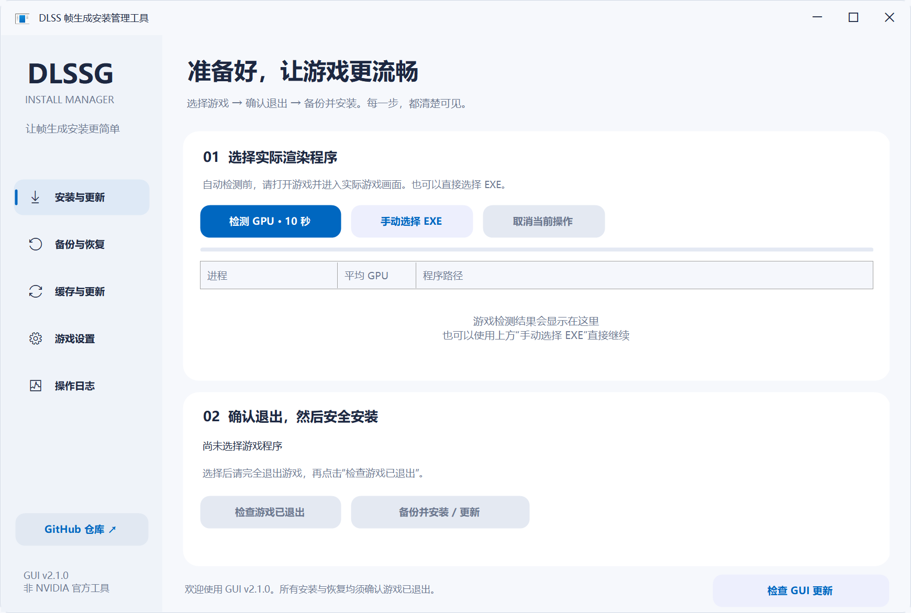
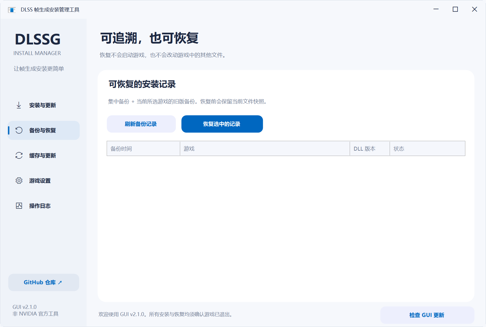
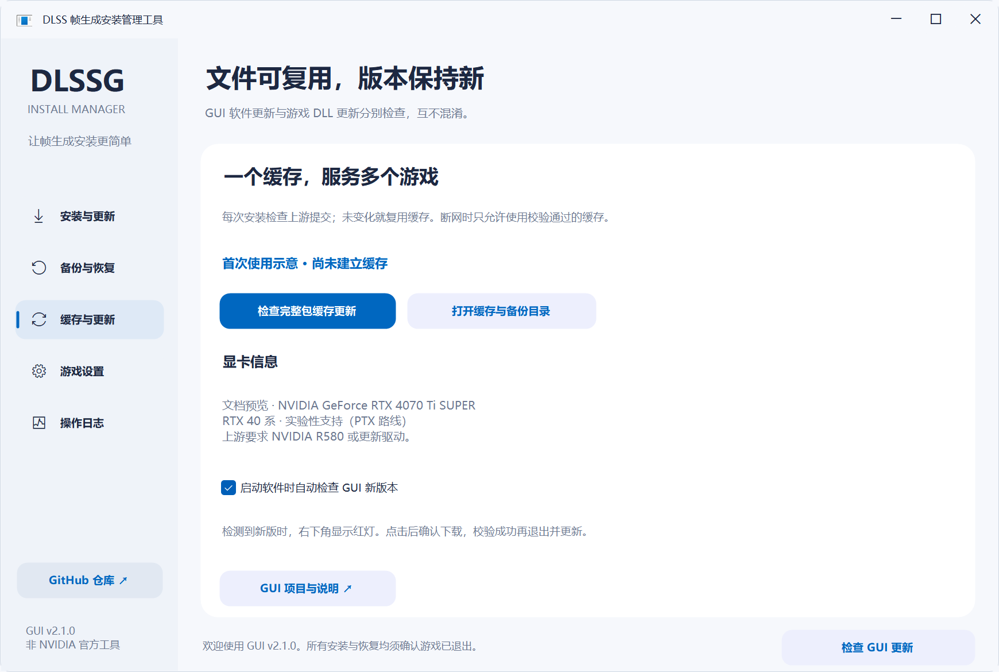
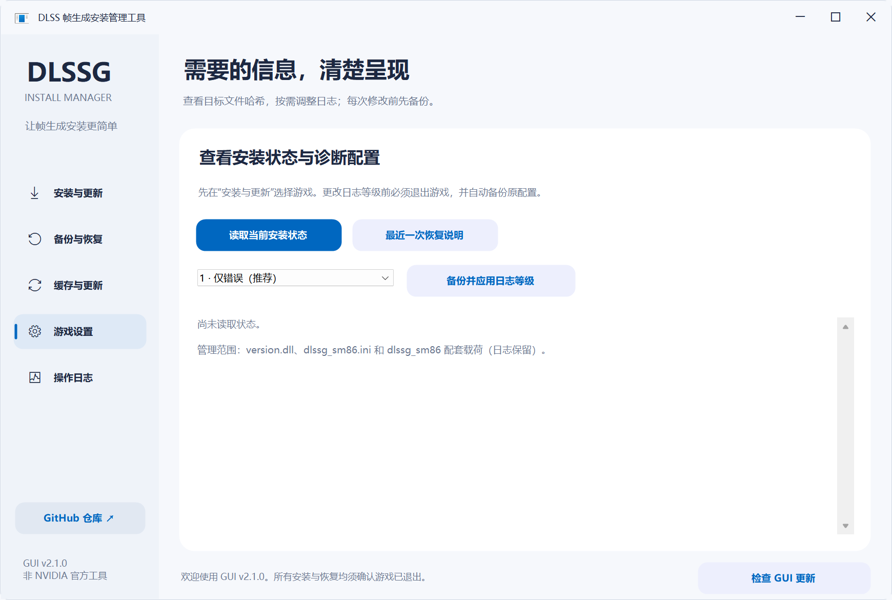
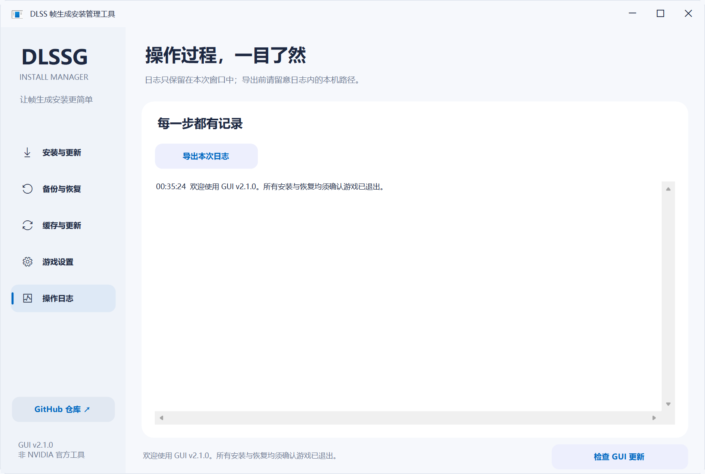
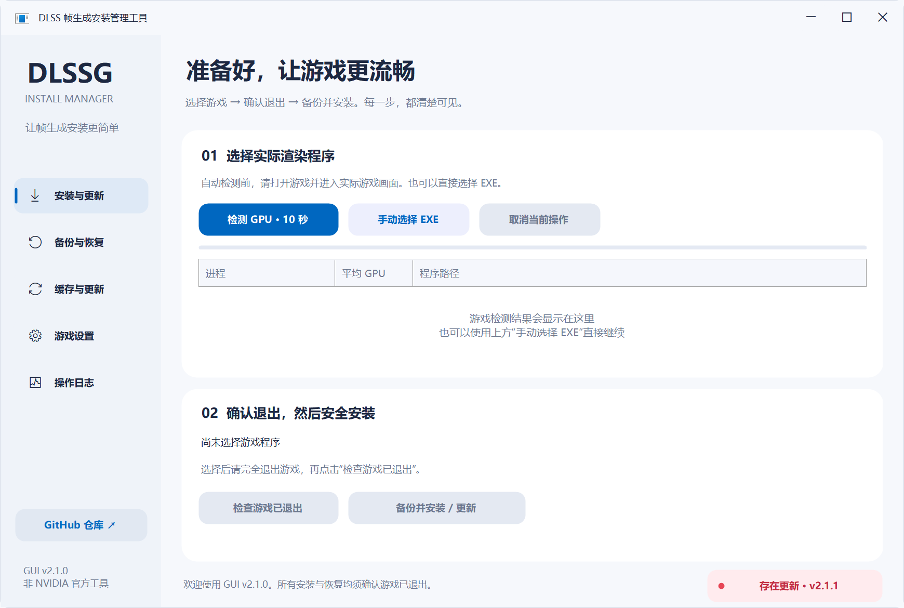

# 界面截图

以下为 v2.1.0 的实际 WinForms 界面渲染，使用 150% DPI 布局。备份列表和安装状态为初始状态。缓存页的 RTX 4070 Ti SUPER 是演示数据，用于展示 40 系实验性支持提示；截图不代表实卡游戏验证。

## 1. 安装与更新

从这里选择游戏程序，检查游戏退出，再备份并安装。没有选择程序时安装按钮为灰色，这是正常的安全限制。

## 2. 备份与恢复

安装产生记录后，在这里刷新并选择恢复点。本图没有创建演示备份，不是假装已给真实游戏安装。

## 3. 缓存与更新

检查完整包缓存、打开集中备份目录，以及开关启动时 GUI 更新检查。显卡区展示实验性支持和 R580+ 驱动要求；正常启动读取实际显卡。

## 4. 游戏设置

先选游戏，再读取安装状态或调整诊断日志等级。没有选游戏时无需点击设置。

## 5. 操作日志

查看本次操作过程，出错时可以导出日志。提交问题前请遮盖个人路径和用户名。

## 6. 右下角更新红灯（模拟新版）

**v2.1.1 为演示版本，不代表已经发布。** 实际仅在存在更高正式版时显示红灯，点击后需确认更新。

