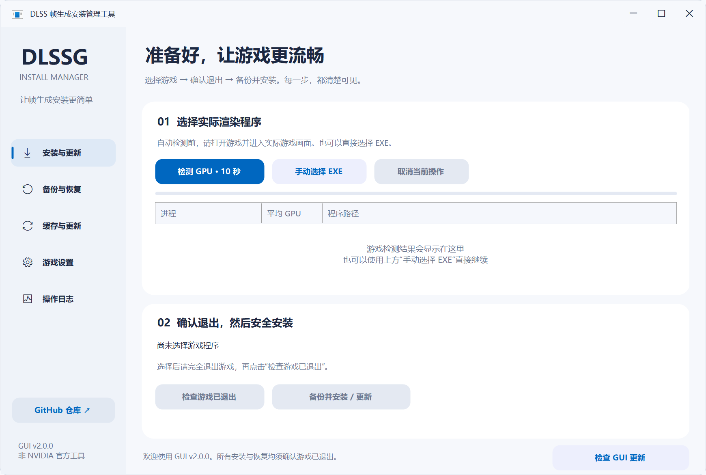
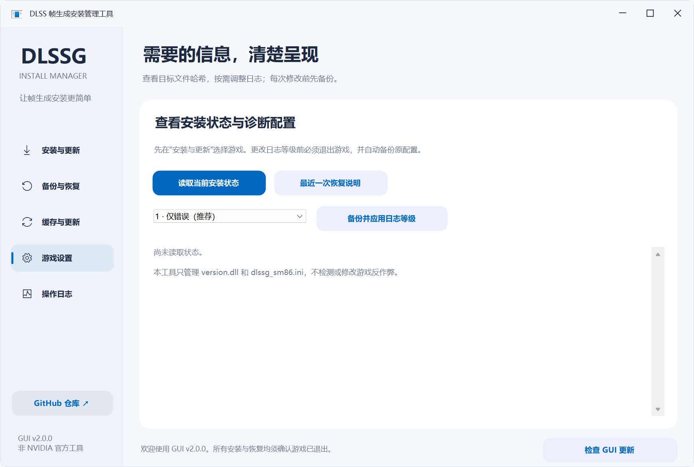
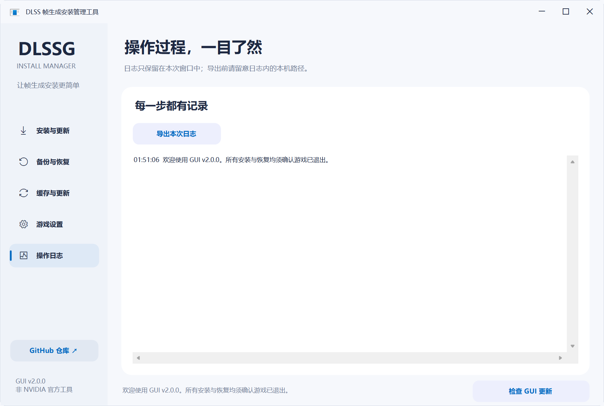

# 界面截图

以下为 v2.0.0 实际 WinForms 界面渲染，使用 150% DPI 布局，不是设计稿。截图模式不联网，不安装、不恢复，也不读取用户游戏备份。备份页为空、设置页未读取是刻意保留的初始状态，不代表真实游戏测试结果。

## 1. 安装与更新

从这里选择游戏程序，检查游戏退出，再备份并安装。没有选择程序时安装按钮为灰色，这是正常的安全限制。

## 2. 备份与恢复

安装产生记录后，在这里刷新并选择恢复点。本图没有创建演示备份，不是假装已给真实游戏安装。

## 3. 缓存与更新

检查公共 DLL 缓存、打开集中备份目录，以及开关启动时 GUI 更新检查。截图中的缓存和显卡文字为文档预览说明；正常启动会读取实际信息。

## 4. 游戏设置

先选游戏，再读取安装状态或调整诊断日志等级。没有选游戏时无需点击设置。

## 5. 操作日志

查看本次操作过程，出错时可以导出日志。提交问题前请遮盖个人路径和用户名。

## 6. 右下角更新红灯（模拟新版）

**本图注入了演示版本 v2.0.1，只展示红点与提示样式，不代表 v2.0.1 已发布。** 实际只会在仓库有更高版本正式发布时显示。点击后仍需用户确认，不会悄悄替换程序。

